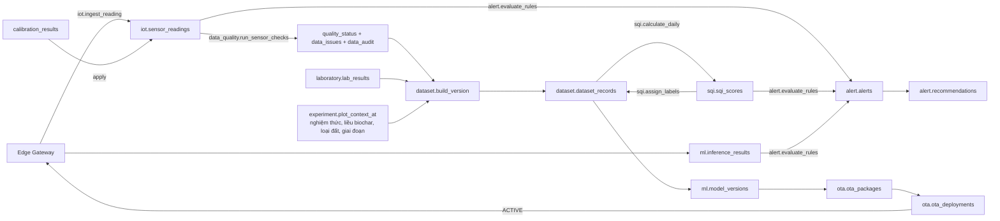
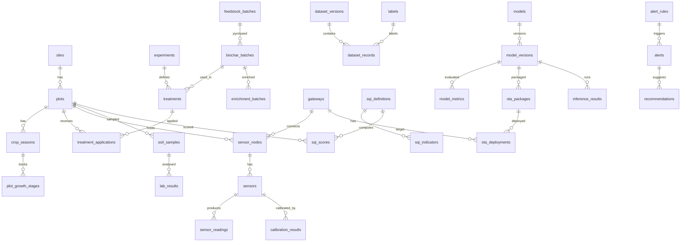

# Database Edge-AIoT giám sát sức khỏe đất – Biochar

Hiện thực PostgreSQL cho tài liệu *Database_Schema_EdgeAIoT_Biochar.docx*: 15 schema theo domain cộng thêm schema `ref` cho danh mục dùng chung. Bộ SQL gồm bảng, ràng buộc, index, partition, hàm xử lý (ingest → QC → dataset → SQI → nhãn → ML/OTA → cảnh báo → KPI), view cho 14 màn hình UI, audit và phân quyền.

## Xem nhanh (không cần cài PostgreSQL)

Thư mục `viewer/` là trình xem chạy trên web. Database PostgreSQL chạy ngay trong Node.js nhờ PGlite. Chỉ cần cài Node.js ≥ 18.

```bash
cd viewer
```
```bash
npm install
```
```bash
npm start
```

Sau đó mở http://localhost:3000.

- **Lần chạy đầu** mất khoảng 1 phút để tạo database và nạp dữ liệu demo. Các lần sau mở ngay.
- **Nơi lưu dữ liệu:** `%LOCALAPPDATA%\edge_aiot_biochar_pgdata`. Chạy `npm run reset` để xóa và tạo lại từ đầu, cần làm mỗi khi sửa file SQL.
- **Các tab:** Tổng quan (KPI nghiệm thu), Monitoring, SQI, Thí nghiệm & Biochar, Lab & Hiệu chuẩn, Data Quality, Dataset, Embedded ML, OTA, Cảnh báo, Kinh tế, Bảng dữ liệu (xem mọi bảng) và SQL.
- **Tab SQL** chạy câu lệnh trong transaction rồi ROLLBACK, nên thử `UPDATE` hay `DELETE` cũng không làm hỏng dữ liệu.

## Chạy trên PostgreSQL thật

Yêu cầu PostgreSQL ≥ 14. TimescaleDB là tùy chọn.

```bash
createdb edge_aiot_biochar
```

```bash
psql -d edge_aiot_biochar -v ON_ERROR_STOP=1 -f run_all.sql
```

Trên production, bỏ dòng `99_demo_seed.sql` trong `run_all.sql`. Nếu máy chủ có TimescaleDB, xem `sql/90_timescale_optional.sql`.

## Cấu trúc file

| File | Nội dung |
|---|---|
| `00_init.sql` | Tạo schema, múi giờ `Asia/Ho_Chi_Minh`, `ref.parameters` (danh mục chỉ tiêu PH, EC, MOISTURE, N, P, K, OC, CEC…) |
| `01_iam.sql` | organizations, users, roles, permissions, role_permissions, user_roles, api_keys |
| `02_farm.sql` | sites, plots, crops, crop_seasons |
| `03_biochar.sql` | feedstock_batches, biochar_batches (nhiệt phân, chỉ tiêu chất lượng, kim loại nặng), enrichment_batches, enrichment_results |
| `04_experiment.sql` | experiments, treatments, treatment_applications, growth_stages, plot_growth_stages, hàm `plot_context_at()` |
| `05_iot.sql` | gateways, sensor_nodes, sensors, sensor_configs, **sensor_readings** (partition theo tháng) |
| `06_calibration.sql` | reference_devices, calibration_sessions, calibration_points, calibration_results, hàm `compute_results()` và `apply()` |
| `07_laboratory.sql` | lab_methods, soil_samples, lab_results, view `v_sensor_vs_lab` |
| `08_data_quality.sql` | quality_rules, quality_checks, data_issues, data_audit, hàm `iot.ingest_reading()` và `run_sensor_checks()` |
| `09_dataset.sql` | labels, datasets, dataset_versions, **dataset_records** (partition), hàm `build_version()` và `freeze_version()`, view readiness |
| `10_sqi.sql` | sqi_definitions, sqi_indicators, sqi_weights, sqi_classes, sqi_scores, sqi_indicator_scores, hàm `calculate_daily()` và `assign_labels()` |
| `11_ml.sql` | models, model_versions, model_metrics, inference_results, view `v_model_acceptance`, hàm `approve_model_version()` |
| `12_ota.sql` | ota_packages, ota_deployments, deployment_events, rollback_events, trigger máy trạng thái, view `v_ota_kpi` |
| `13_alert.sql` | alert_rules, alerts, recommendations, hàm `evaluate_rules()` |
| `14_reporting.sql` | kpis, kpi_measurements, reports, economic_results, các view KPI và dashboard |
| `15_audit.sql` | audit_logs, access_logs, trigger audit gắn vào 26 bảng quan trọng |
| `16_reference_data.sql` | Vai trò, quyền, 12 KPI nghiệm thu, luật QC, nhãn, SQI-v1.0, luật cảnh báo |
| `17_db_roles.sql` | Role `<schema>_reader` / `<schema>_writer`, `edge_gateway`, `app_backend` |
| `90_timescale_optional.sql` | Hypertable, nén dữ liệu, continuous aggregate theo giờ |
| `99_demo_seed.sql` | Dữ liệu demo: 1 Gateway, 3 Node, 3 nghiệm thức, 45 ngày đo 15 phút/lần |

Ngoài thư mục `sql/`:

| Thư mục | Nội dung |
|---|---|
| `viewer/` | Trình xem web cho database (xem mục *Xem nhanh*) |
| `ml/` | Embedded ML (TV6): notebook huấn luyện, mô hình, SQL ghi metrics thật. Xem [ml/README.md](ml/README.md) |

## Luồng dữ liệu



## ERD lõi



## Thay đổi so với tài liệu

Những thay đổi dưới đây dùng để sửa các điểm chưa khớp trong bản thiết kế:

1. **Liên kết plot và treatment đi qua `treatment_applications`**, có thời gian hiệu lực và liều thực tế. Trong tài liệu, `treatments` không có `plot_id`.
2. **`sensor_readings` gắn khóa theo một đầu dò đa chỉ tiêu** (loại 7-in-1). Bảng có thêm `node_id`, `gateway_id`, `seq_no`, `received_at`, `raw_payload` (giá trị thô trước hiệu chuẩn), `quality_flags` và `timestamp_valid`.
3. **PK của bảng partition chứa cột thời gian:** `(reading_id, measured_at)` và `(record_id, observed_at)`. Ràng buộc `UNIQUE (sensor_id, measured_at)` chặn bản tin bị gửi lại; bản tin trùng được ghi thành issue `DUPLICATE` và tính vào KPI lỗi/trùng.
4. **Đổi tên các cột thời gian:** `timestamp` → `measured_at` / `observed_at` / `inferred_at` / `period_start`, để tránh dùng từ khóa SQL. `pH` → `ph`.
5. **`soil_samples` có thêm thông tin để đối chiếu sensor với lab:** `sampled_at`, độ sâu, tọa độ và `near_node_id`.
6. **`dataset_records` lưu đủ các trường đồng bộ theo yêu cầu:** thời gian, vị trí, nghiệm thức, loại đất, liều biochar, giai đoạn sinh trưởng. Các đặc trưng chính là cột riêng (theo ghi chú "JSONB không thay thế trường phân tích"). Bảng có thêm `split` và `group_key` để chống leakage.
7. **Bổ sung một số bảng:**
   - `sqi_classes` và `sqi_indicator_scores` cho màn hình 04 (chi tiết từng chỉ tiêu).
   - `sqi_scores` có thêm `treatment_id` và FK `definition_id`.
   - `ota.deployment_events` làm timeline OTA.
   - `iam.role_permissions` và `iam.api_keys`.
   - `calibration.reference_devices`.
   - `experiment.plot_growth_stages`.
8. **`recommendations` nằm trong schema `alert`**, theo bảng danh sách của tài liệu. Mục 4 của tài liệu ghi là `reporting.recommendations`.

## Ánh xạ màn hình UI → database

| Màn hình | Nguồn dữ liệu chính |
|---|---|
| 01 Dashboard | `reporting.v_dashboard_plots`, `reporting.v_acceptance_summary` |
| 02 Bản đồ | `farm.plots.boundary_geojson`, tọa độ `iot.gateways` / `iot.sensor_nodes`, `last_seen_at`, `status` |
| 03 Monitoring | `iot.sensor_readings` (index `(plot_id, measured_at)`), `raw_payload` / `quality_status`, `iot.sensor_readings_hourly` (Timescale) |
| 04 SQI | `sqi.sqi_scores`, `sqi.sqi_indicator_scores`, `sqi.sqi_weights`, `sqi.v_treatment_comparison` |
| 05 Thí nghiệm | `experiment.*`, `farm.crop_seasons` |
| 06 Biochar | `biochar.*` |
| 07 Lab | `laboratory.*`, `laboratory.v_sensor_vs_lab` |
| 08 Data Quality | `data_quality.*`, `reporting.v_data_collection_daily` |
| 09 Dataset | `dataset.*`, `dataset.v_version_readiness` (≥10.000 quan sát, leakage) |
| 10 Embedded ML | `ml.*`, `ml.v_model_acceptance` |
| 11 OTA | `ota.*`, `ota.v_ota_kpi` |
| 12 Cảnh báo | `alert.*` (evidence JSONB chứa bằng chứng SQI/AI) |
| 13 Báo cáo | `reporting.reports`, `reporting.economic_results`, `reporting.kpi_measurements` |
| 14 Quản trị | `iam.*`, `iot.sensor_configs`, `audit.*` |

## Tiêu chí nghiệm thu (`reporting.v_acceptance_summary`)

Các ngưỡng giữ nguyên theo hồ sơ:

- Thu thập dữ liệu thành công ≥ 90%; timestamp hợp lệ ≥ 90%.
- Lỗi/trùng ≤ 5%; thiếu sau xử lý ≤ 5%.
- ≥ 10.000 quan sát hợp lệ.
- Accuracy ≥ 90%, Precision ≥ 90%, Recall ≥ 80%, F1 ≥ 85%; suy luận ≤ 2 s.
- OTA thành công ≥ 95%; thời gian cập nhật ≤ 10 phút.

Với dữ liệu demo, cả 12 KPI đều đạt. Ví dụ: 12.325 quan sát hợp lệ, thiếu sau QC 4,9%, lỗi/trùng 1,72%. Số liệu ML và OTA trong demo là giả lập.

## Vận hành

- **Partition:** chạy định kỳ (pg_cron hoặc job ngoài) lệnh `SELECT ref.ensure_monthly_partitions('iot.sensor_readings', current_date, 3);` và lệnh tương tự cho `dataset.dataset_records`.
- **Ghi nhận người thực hiện trong audit:** ứng dụng đặt `SET LOCAL app.user_id = '<uuid>'` trong mỗi transaction. Khi sửa tay dữ liệu, đặt thêm `app.change_reason`.
- **Edge Gateway:** dùng role `edge_gateway`, chỉ được gọi `iot.ingest_reading()`, ghi `ml.inference_results` và cập nhật tiến độ OTA. Store-and-forward nằm ở phía gateway; database đã chống trùng khi gateway gửi lại.
- **SQI-v1.0:** ngưỡng và trọng số trong `16_reference_data.sql` chỉ là giá trị khởi tạo. Cần hiệu chỉnh bằng PCA/MDS hoặc ý kiến chuyên gia rồi tạo phiên bản SQI mới. Không sửa phiên bản đang dùng.
